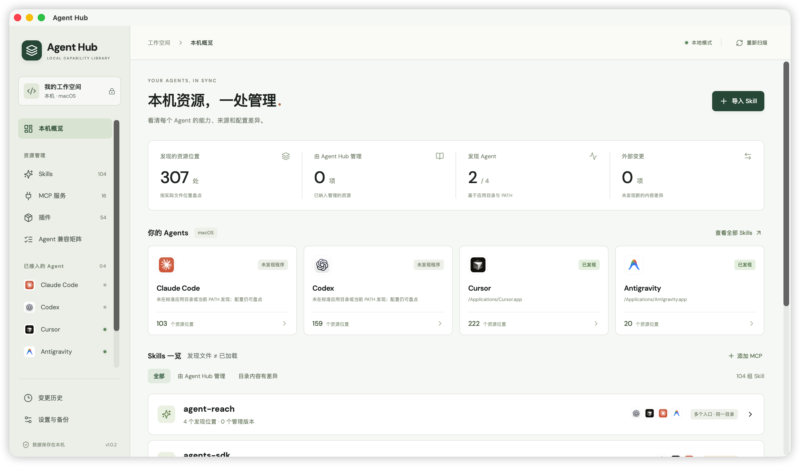
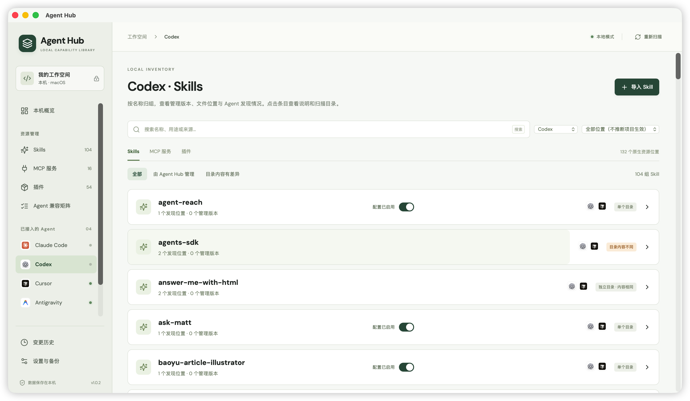

# Agent Hub

集中管理 Claude Code、Codex、Cursor 和 Antigravity 的 Skills、MCP 配置及本地插件清单，面向 macOS、Windows 和 Linux。

Agent Hub 读取各工具的本地配置，将分散在不同目录中的资源汇总到一个桌面界面。你可以维护共享 Skill 库、按项目分配 Skills、编辑 MCP 基础配置，并在写入前查看差异。

## 功能

- **资源浏览**：扫描已知的全局配置目录，以及手动添加的项目目录。
- **Skill 管理**：从本地目录或 HTTPS Git 仓库导入，记录来源与版本，支持固定版本、检查更新和按目标分配。
- **MCP 配置**：按各工具的格式读写基础配置，保留已有凭据和扩展字段，支持手动检查 stdio 与 HTTP 连接。
- **变更记录**：资源文件变更前展示差异并保存备份，支持撤销；目标文件已被其他程序修改时，阻止直接覆盖。
- **插件清单**：展示已知目录中的插件声明，并提供对应工具的官方管理文档入口。
- **导入导出**：迁移共享 Skill 库、来源、版本和分配参考，不包含 MCP 配置或 OAuth 凭据。

资源出现在清单中，表示已发现对应文件。是否已安装、启用或加载，仍需在对应工具中确认。各工具的配置格式和加载规则存在差异，兼容范围见 [兼容性说明](docs/research/agent-compatibility.md)。

## 面向开发者的工作台

Agent Hub 将分散在 Claude Code、Codex、Cursor 和 Antigravity 配置目录中的 Skills、MCP 服务与插件信息汇总到本地界面。开发者可以快速盘点不同 Agent 当前发现了什么，并在修改配置前了解目标文件和影响范围。

### 一眼掌握本机 Agent 资源



概览页集中展示已发现的 Agent、资源位置和管理状态。可以从这里进入某个 Agent 的 Skills 清单，查看资源来自哪些目录、不同 Agent 是否共享同一份 Skill，以及是否存在内容差异。清单反映本机扫描结果；具体资源是否已加载，仍由对应 Agent 决定。

### 按 Agent 检索与管理 Skills



Skills 页面支持按名称、用途或来源搜索，并按 Agent 和位置筛选。相同 Skill 在多个位置出现时，可以对照发现位置、管理版本和目录内容状态，减少手动检查隐藏配置目录的工作。通过 Agent Hub 管理的 Skill 还可按目标启用或停用，并保留来源和版本信息。

### 帮开发者节省的日常操作

- **减少重复配置**：将常用 Skill 放入共享库，再分配给需要的 Agent 或项目；支持从本地目录和 HTTPS Git 仓库导入。
- **更快定位差异**：集中搜索多个 Agent 的资源，识别重复发现位置、目录内容差异和管理状态。
- **降低配置修改风险**：编辑 MCP 等配置时先查看变更差异并保存备份；需要时可从变更历史撤销。检测到目标文件被外部程序修改时，会阻止直接覆盖。
- **保留现有配置**：更新 MCP 基础配置时尽量保留既有凭据和扩展字段，避免因工具间格式不同而重写整份配置。
- **便于迁移和盘点**：导入或导出共享 Skill 库及其来源、版本和分配参考；插件清单帮助快速找到对应 Agent 的插件管理入口。

Agent Hub 以本机数据为中心，不要求将配置同步到远端服务。添加项目目录、导入资源、检查 Git 来源或连接 MCP 服务时，均由开发者主动选择或确认。

## 从源码运行

本项目使用 Tauri 2、React 19、TypeScript 和 Rust。三平台适配与验证进度见 [平台说明](docs/cross-platform.md)。

准备以下环境：

- Node.js 与 npm
- Rust 工具链

另外需要安装对应平台的构建依赖：

| 平台    | 构建依赖                                             |
| ------- | ---------------------------------------------------- |
| macOS   | Xcode Command Line Tools                             |
| Windows | Visual Studio C++ Build Tools、Windows SDK、WebView2 |
| Linux   | WebKitGTK 4.1、GTK 3 等系统库                        |

各系统的安装步骤见 [Tauri 环境准备](https://v2.tauri.app/start/prerequisites/)。从 Git 导入 Skills 还需要安装 Git。

在项目根目录执行：

```bash
npm ci
npm run tauri dev
```

## 构建

```bash
npm run tauri build
```

安装包输出至 `src-tauri/target/release/bundle/`：

| 平台    | 安装包                      |
| ------- | --------------------------- |
| macOS   | `.app`、`.dmg`              |
| Windows | NSIS `.exe`、WiX `.msi`     |
| Linux   | `.deb`、`.rpm`、`.AppImage` |

各平台安装包需在对应系统上构建。仓库提供 [三平台检查](.github/workflows/check.yml) 和 [安装包构建](.github/workflows/release.yml) 工作流；CI 的 Windows 产物采用 NSIS 安装包。

如需调试构建：

```bash
npm run tauri build -- --debug
```

调试产物位于 `src-tauri/target/debug/bundle/`。指定 `--target` 后，产物位于对应目标架构的目录中。更新包使用独立签名校验；当前未配置操作系统代码签名与 macOS 公证。

## 应用更新

桌面应用启动后会检查 GitHub Releases，发现新版本时显示提示。也可在「设置与备份」中手动检查。点击「下载更新」后会显示进度并校验签名；保存工作后点击「安装并重启」完成更新。网络不可用时仍可正常使用当前版本。

macOS 和 Windows 支持应用内更新；Linux 的应用内更新用于 AppImage，DEB/RPM 安装请使用相应的新安装包或包管理器。v1.0.6 及更早版本没有更新器，需要手动安装一次带更新器的新版本。

发布者仍使用 `npm run release`。CI 构建并签名更新包，生成 `latest.json`，在全部附件上传后公开 Release。签名私钥保存在仓库外，通过 GitHub Actions Secret `TAURI_SIGNING_PRIVATE_KEY` 提供；配置中的公钥用于验证更新，不能随意更换。详细维护步骤见 [更新发布说明](docs/auto-update.md)。

## 本地数据与备份

应用数据保存在当前用户的数据目录：

| 平台    | 默认路径                                                    |
| ------- | ----------------------------------------------------------- |
| macOS   | `~/Library/Application Support/dev.agenthub.desktop`        |
| Windows | `%LOCALAPPDATA%\dev.agenthub.desktop`                       |
| Linux   | `~/.local/share/dev.agenthub.desktop`，遵循 `XDG_DATA_HOME` |

项目目录、Skill 来源和导入文件通过系统文件选择器添加。资源文件写入前需确认变更；Git 获取和 MCP 连接检查也需手动确认。

macOS 和 Linux 使用 `0700` 数据目录及 `0600` 备份文件；Windows 使用仅允许当前用户和 SYSTEM 访问的受限 ACL。配置备份可能包含原有凭据，请妥善保管。Skill 导入会拦截常见凭据文件名，但无法检查内容中包含的所有敏感信息。

## 开发

| 命令                                                        | 用途                                 |
| ----------------------------------------------------------- | ------------------------------------ |
| `npm run build`                                             | TypeScript 检查与前端构建            |
| `npm run bindings`                                          | 生成 Rust 命令对应的 TypeScript 绑定 |
| `npm run format`                                            | 格式化前端代码与配置                 |
| `cargo check --manifest-path src-tauri/Cargo.toml`          | Rust 编译检查                        |
| `cargo test --manifest-path src-tauri/Cargo.toml`           | 运行 Rust 测试                       |
| `cargo fmt --manifest-path src-tauri/Cargo.toml -- --check` | Rust 格式检查                        |

修改 Rust 命令接口后，运行 `npm run bindings` 更新绑定。运行 `npm run release` 并选择 GitHub 发布后，脚本会更新版本号、创建版本提交和注释 Tag，再推送到 GitHub。CI 检查版本一致性、构建三平台安装包，并创建 GitHub Release；Release 页面会列出更新说明与可下载的安装包。预发布版本号（如 `1.1.0-beta.1`）会标记为预发布。

也可以推送已有版本 Tag 触发发布；手动运行工作流时需填写已存在的版本 Tag。构建与测试必须全部通过才会创建 Release。GitHub 自动更新说明按合并的 PR 与标签生成，建议每个 PR 加上 `feature`、`bug` 或 `documentation` 标签。

## 文档

- [产品说明](docs/product-spec.md)
- [Agent 兼容性说明](docs/research/agent-compatibility.md)
- [实现与验证记录](docs/implementation.md)
- [文件访问与命令权限](docs/security-scope.md)
- [跨平台适配与验证](docs/cross-platform.md)

## 许可证

本项目原创代码采用 [MIT License](LICENSE)。Copyright © 2026 xdffish。

第三方 Skills、依赖、字体和图片沿用各自的许可证及版权声明，不适用本项目的 MIT 授权。第三方内容的授权核对尚未完成。
